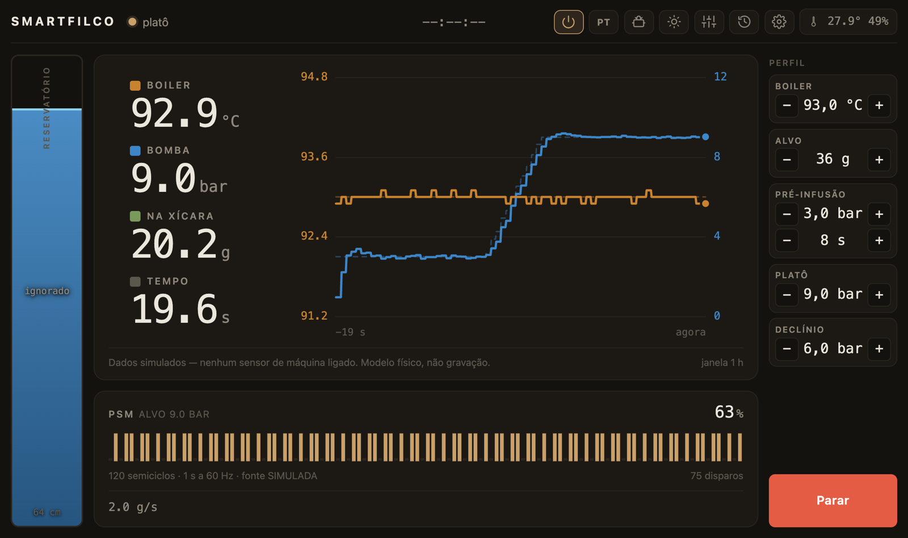
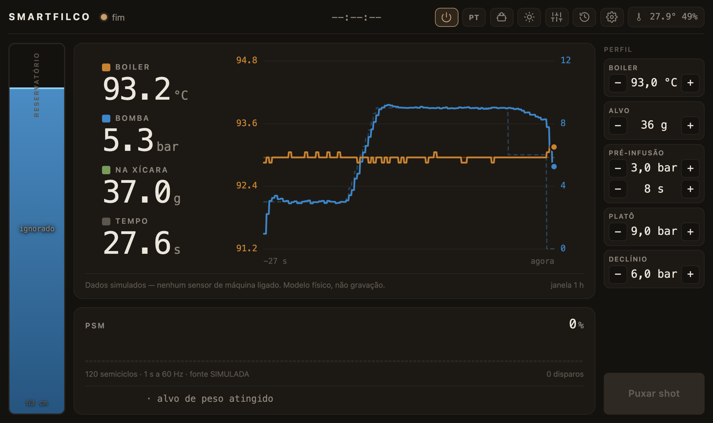
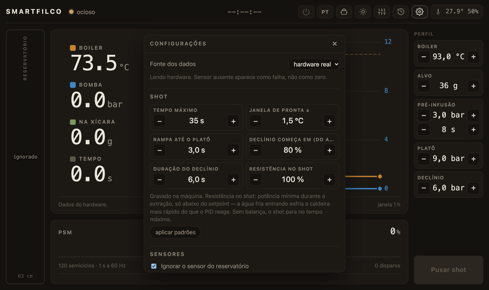
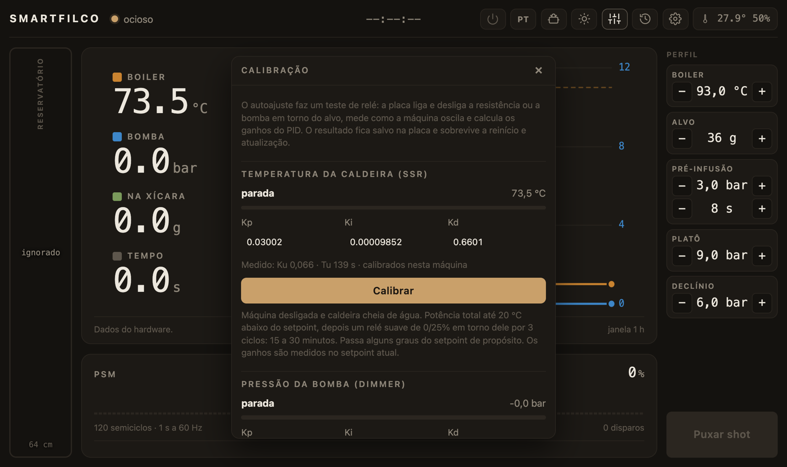
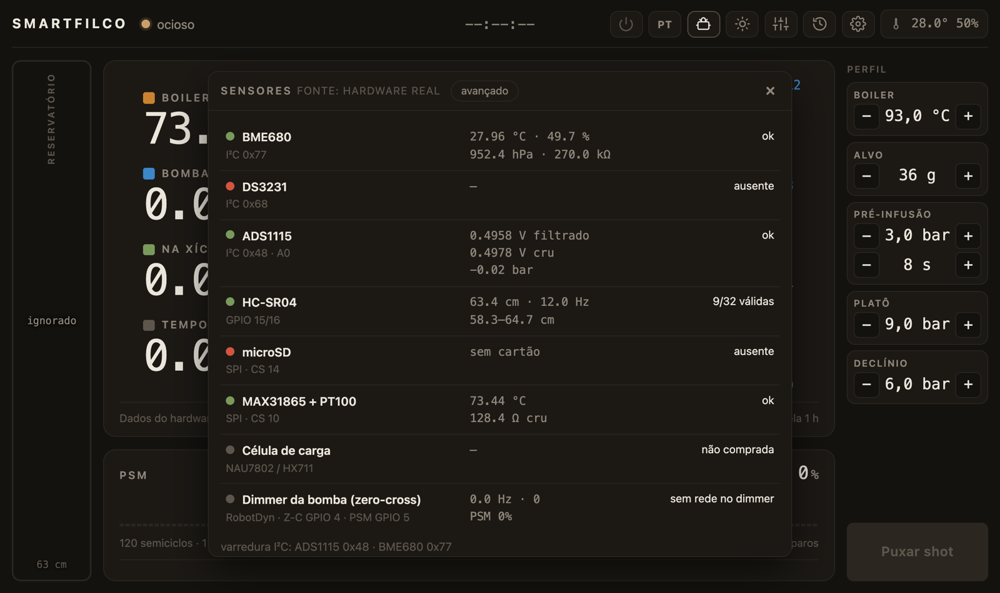
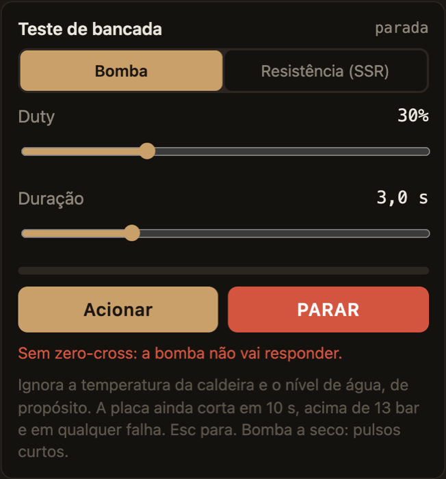
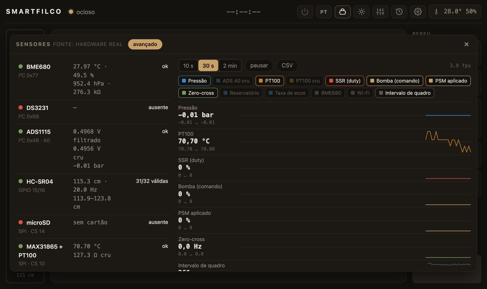

# SmartFilco

**Uma cafeteira espresso Philco de entrada transformada em máquina com controle
de verdade:** temperatura por PID, pressão em malha fechada, perfil de extração,
gráfico ao vivo e tudo ajustável pelo navegador — com um ESP32-S3 e peças que
custam menos que a própria máquina.



> ⚠️ **Este projeto mexe com 220 V e água quente sob pressão.** Leia
> [docs/07 — Segurança](docs/07-seguranca-e-calibracao.md) antes de abrir a sua máquina.

---

## A ideia

A Philco 15 Bar (igual à 20 Bar) é uma máquina de caldeira única com bomba
vibratória Ulka. De fábrica ela tem um termostato bimetálico que oscila vários
graus, uma bomba que só sabe ficar ligada no máximo, e nenhuma forma de saber o
que aconteceu no shot. O café sai bom ou ruim e você não sabe por quê.

O SmartFilco põe um microcontrolador no meio disso. Ele **mede** (temperatura da
caldeira, pressão, massa na xícara), **decide** (PID de temperatura, controle de
pressão seguindo um perfil) e **atua** (resistência por SSR, bomba por dimmer). A
interface é uma página web servida pela própria placa: abre no celular ou no
computador, sem app e sem nuvem.

É o mesmo espírito do [Gaggiuino](https://github.com/Zer0-bit/gaggiuino), com outra
arquitetura: ESP32-S3, Wi-Fi, atualização de firmware pela rede e um simulador
físico embutido para testar tudo sem molhar nada.

**Estado em 10/11/2026:** a máquina tira café. Primeiro shot completo com moagem
conhecida: 32 g em 35 s, com pré-infusão, platô de 9 bar e temperatura controlada.

---

## O que ela faz

- 🌡️ **Temperatura por PID** — PT100 na parede da caldeira, setpoint ajustável em
  0,1 °C. A máquina só se diz *pronta* dentro de uma janela configurável.
- 💧 **Perfil de pressão** — pré-infusão (pressão e tempo), rampa, platô e declínio,
  com a bomba controlada por PSM (pulso a pulso, sincronizado com a rede).
- 🔥 **Compensação de temperatura no shot** — a água fria que entra derruba a
  caldeira mais rápido do que qualquer PID reage. Durante a extração a resistência
  entra com potência mínima configurável, antes de o sensor ver a queda.
- 🎛️ **Autocalibração das duas malhas** — um botão. A placa faz um teste de relé,
  mede como *esta* máquina responde e calcula os ganhos do PID. Fica salvo.
- 📈 **Gráfico ao vivo** — temperatura e pressão sobrepostas com os alvos
  tracejados, número grande para cada grandeza, trem de pulsos real da bomba.
- ⚙️ **Tudo ajustável, nada fixo no código** — perfil, tempos, janela de pronta,
  ganhos; com "aplicar padrões" para voltar ao começo. Gravado na placa.
- 🧪 **Bancada de testes** — acionar bomba ou resistência com duty e tempo fixos,
  para validar fiação sem puxar um shot.
- 🖥️ **Simulador embutido** — um modelo físico de caldeira, bomba e puck roda na
  própria placa. Troca-se a fonte dos dados e a interface inteira funciona sem
  hardware, inclusive com falhas injetadas.
- 🛡️ **Proteções independentes da interface** — sonda aberta, sobretemperatura,
  sobrepressão, bomba ligada tempo demais, reservatório seco. Valem mesmo com o
  navegador fechado.
- 📡 **Atualização pela rede (OTA)** com rollback automático se o firmware novo
  não conectar.
- 🌍 **Interface em português e inglês.**

## O que ainda não tem

Sendo honesto sobre o que falta:

- **Balança.** A célula de carga sob a xícara ainda não foi comprada. Sem ela a
  massa lê zero e **o shot para pelo tempo máximo**, não pelo peso — e o declínio
  de pressão, que começa numa fração do alvo em gramas, não acontece. O firmware
  e a interface já estão prontos para ela.
- **Sensor do reservatório confiável.** O HC-SR04 lê ~10× a distância real nesta
  bancada. Por enquanto há uma opção para ignorá-lo.
- **Registro dos shots no cartão.** Implementado (CSV a 20 Hz no microSD), mas o
  módulo está fora da bancada no momento.
- **Vapor.** O controle é só para extração.
- **Tela física.** Por ora a interface é web; uma tela fixa na máquina é a fase
  seguinte ([por quê duas placas](docs/05-firmware-arquitetura.md)).
- **Layout de celular.** Funciona, mas o topo se embola em telas estreitas — a
  página foi desenhada primeiro para 800×480 deitado.

---

## A interface

Tudo vive numa tela que não rola — painel de máquina com dedo sujo de café não
pode exigir arrastar para achar a pressão.

### Durante o shot



À esquerda, os quatro números que importam: **caldeira, pressão, massa na xícara,
tempo**. À direita deles, o gráfico sobrepõe temperatura (laranja, escala à
esquerda) e pressão (azul, escala fixa de 0 a 12 bar à direita). As linhas
tracejadas são o que o perfil está pedindo naquele instante — dá para ver a
pressão real seguindo o alvo da pré-infusão, subindo na rampa e segurando o platô.

Embaixo, o **trem de pulsos do PSM**: cada barra é um semiciclo da rede que foi
entregue à bomba. Não é animação — é o mesmo acumulador que o firmware usa.

Na coluna da direita fica o **perfil**: caldeira, alvo em gramas, pré-infusão
(pressão e duração), platô e declínio. Cada toque em − / + vai direto para a
placa, que limita a faixa e grava.

> Estas duas capturas vêm do simulador embutido, para mostrar um shot inteiro com
> balança. O rodapé do gráfico sempre diz de onde vêm os dados.

### Configurações



O que não é perfil de sabor, mas muda o comportamento da máquina:

| Ajuste | Padrão | O que faz |
|---|---|---|
| Tempo máximo | 35 s | Rede de segurança; sem balança, é quem encerra o shot |
| Janela de pronta | ±1,5 °C | Quão perto do setpoint a caldeira precisa estar |
| Rampa até o platô | 3 s | Transição da pré-infusão para a pressão cheia |
| Declínio começa em | 80 % do alvo | Fração da massa em que a pressão começa a aliviar |
| Duração do declínio | 6 s | Quanto tempo leva o alívio |
| Resistência no shot | 100 % | Potência mínima durante a extração (só abaixo do setpoint) |

Também aqui: escolher entre **hardware real e simulado**, ignorar o sensor do
reservatório, e no modo simulado mexer na moagem, temperatura ambiente, potência da
resistência e velocidade do tempo, ou injetar falhas.

Se a caldeira passou alguns décimos do setpoint (sempre passa um pouco), aparece um
botão **Destravar** acima de *Puxar shot* — a decisão de tirar o café fora da janela
é sua, não da máquina.

### Calibração



Cada máquina é diferente: a caldeira desta Philco, cortada a 100 % exatamente no
setpoint, ainda sobe **19 °C** pelo calor guardado. Ganhos copiados de outro projeto
não servem. Por isso a calibração é feita na própria máquina, com um botão:

- **Temperatura:** aquece a toda até 20 °C abaixo do setpoint, depois liga e desliga
  a resistência entre 0 e 25 % em torno dele por alguns ciclos (15 a 30 minutos).
- **Pressão:** com um puck de café no porta-filtro, liga e desliga a bomba em torno
  de 6 bar por poucos segundos.

Da oscilação medida saem o ganho e o período críticos (Ku, Tu) e daí os ganhos pelo
método de Tyreus–Luyben, mais conservador que Ziegler–Nichols — caldeira passando do
ponto é café queimado, pressão passando é puck rasgado. Se o resultado sai fora de
uma faixa plausível, a calibração é recusada e mostra o que mediu. Com "editar à mão"
dá para ajustar Kp, Ki e Kd diretamente.

### Sensores



Uma linha por peça: onde ela está ligada, o valor cru que chega e um veredito
(*ok*, *ausente*, *não comprada*). Presente no barramento, saudável e implementado são
três coisas diferentes — esta bancada já teve sensor respondendo com número
inventado.

No modo **avançado**, cada grandeza ganha um osciloscópio de 10 s a 2 min, com pausa
e exportação para CSV, e o painel de **teste de bancada**:



Bomba ou resistência, duty e duração fixos. O teste ignora temperatura e nível de
propósito (é para testar fiação), mas a placa ainda corta sozinha por tempo, por
sobrepressão e em qualquer falha.



---

## Como funciona

```
 sensores                        ESP32-S3                         atuadores
 ────────                        ────────                         ─────────
 PT100 ── MAX31865 ──SPI──┐                                ┌── SSR-40DA ── resistência
 pressão 0–13,8 bar       │   ┌─────────────────────────┐  │
   └─ ADS1115 ──I²C───────┼──▶│ core 1: laço de 100 Hz  │──┤
 célula de carga (futuro) │   │  proteções → PID → FSM  │  └── dimmer RobotDyn (PSM) ── bomba Ulka
 HC-SR04 (reservatório) ──┤   ├─────────────────────────┤        ▲
 zero-cross do dimmer ────┘   │ core 0: Wi-Fi, HTTP,    │        └── zero-cross (ISR em IRAM)
                              │  WebSocket 30 Hz, OTA   │
                              └───────────┬─────────────┘
                                          │  ws://smartfilco.local/ws
                                       navegador
```

### O shot, passo a passo

A máquina é uma máquina de estados, e o nome do estado aparece no topo da tela:

1. **Ocioso** — tudo desligado. Só sai daqui pelo botão de ligar.
2. **Aquecendo** — PID levando a caldeira ao setpoint.
3. **Pronta** — dentro da janela. *Puxar shot* habilita.
4. **Pré-infusão** — pressão baixa (3 bar) para molhar o puck por igual. Termina pelo
   tempo ou quando o puck já segura a pressão, o que vier primeiro.
5. **Rampa** — sobe até a pressão do platô.
6. **Platô** — 9 bar sob controle PI.
7. **Declínio** — a bomba alivia aos poucos até a pressão final.
8. **Fim** — parou por peso, por tempo ou à mão; o motivo aparece na tela. Volta a
   *aquecendo* em seguida.

### Temperatura

PID com derivada **sobre a medida** e **filtrada** — a forma ingênua amplifica o
ruído do sensor 100× a 100 Hz, e na simulação isso fazia o SSR chavear a esmo até a
caldeira bater na proteção. O SSR é acionado por janela de 1 s (PWM lento),
adequado à inércia da caldeira. Durante o shot, a *resistência no shot* entra como
alimentação direta, porque o sensor na parede só vê a água fria dezenas de segundos
depois.

### Pressão

A bomba vibratória não aceita ângulo de fase: em potência baixa o pistão não
completa o curso e ela só zumbe. Então o dimmer funciona por **PSM**: cada ciclo da
rede é entregue inteiro ou pulado, com um acumulador de Bresenham distribuindo os
disparos. Um PI fecha a malha na pressão medida.

O **declínio é malha aberta de propósito**: sem válvula de 3 vias, a pressão nesta
máquina só cai sangrando pelo puck. Um PID com alvo decrescente acumularia erro
contra um limite físico; em vez disso, a potência da bomba é reduzida em rampa
programada e o que sair é registrado.

### Segurança

As proteções rodam **antes** do controle, a cada ciclo, sem consultar nada da
interface. Qualquer uma delas desliga resistência e bomba e trava a máquina em
*falha* até alguém limpar:

| Proteção | Limite |
|---|---|
| Sonda do PT100 aberta ou em curto | 0,5 s seguidos de leitura inválida |
| Sobretemperatura | 160 °C |
| Sobrepressão | 13 bar (o sensor vai até 13,8) |
| Bomba ligada tempo demais | 60 s |
| Reservatório seco | nível abaixo do mínimo (desativável) |

Estes limites são fixos no código, ao contrário de todo o resto: são segurança, não
preferência. No hardware, o fusível térmico original continua no circuito e o
termostato de vapor fica em série com o SSR, como backstop contra SSR em curto ou
firmware travado.

---

## Hardware

| Função | Peça | Ligação |
|---|---|---|
| Controlador | ESP32-S3-WROOM-1 N16R8 (devkit) | — |
| Temperatura | PT100 classe A, 3 fios, de superfície + MAX31865 (Rref 430 Ω) | SPI · CS GPIO10 |
| Pressão | Transdutor 0–13,8 bar, 0,5–4,5 V, 1/8" NPT + ADS1115 a 5 V | I²C GPIO8/9, via level shifter |
| Resistência | SSR-40DA com dissipador | GPIO6 |
| Bomba | Dimmer RobotDyn 8A, modo PSM | Z-C GPIO4 · PSM GPIO5 |
| Reservatório | HC-SR04 | TRIG GPIO15 · ECHO GPIO16 |
| Log | Módulo microSD | SPI · CS GPIO14 |
| Ambiente | BME680 | I²C 0x77 |
| Massa | Célula de carga + NAU7802 ou HX711 | *a comprar* |

SPI compartilhado em SCK 12 / MOSI 11 / MISO 13. Pinagem completa, armadilhas do
S3 (GPIO33–37 são da PSRAM octal) e o lado de 220 V em
[docs/02](docs/02-arquitetura-eletrica-pinout.md). Lista de compras com preços em
[docs/04](docs/04-bom-lista-de-compras.md).

---

## Firmware

ESP-IDF v5.5.5, em [`firmware/bringup/`](firmware/bringup/). Os módulos principais:

| Arquivo | Papel |
|---|---|
| `main/maquina.c` | Máquina de estados do shot, PIDs, perfil, proteções, calibração |
| `main/autotune.c` | Autoajuste por relé, sem hardware — testável no computador |
| `main/hal.h` · `hal_real.c` · `hal_sim.c` | Fronteira com o mundo: hardware real ou modelo físico |
| `main/main.c` | Wi-Fi, servidor HTTP/WebSocket, OTA, comandos |
| `main/index.html` | A interface inteira, embutida no firmware |
| `main/max.c` · `ads.c` · `ultra.c` · `sd.c` · `rtc.c` | Drivers dos sensores |

`maquina.c` só fala com o mundo pelo `hal.h` e não sabe se está no hardware ou no
simulador — é isso que faz o teste no simulador valer para a máquina real.

### Compilar e gravar

```bash
cp firmware/bringup/main/wifi_cfg.h.exemplo firmware/bringup/main/wifi_cfg.h
$EDITOR firmware/bringup/main/wifi_cfg.h          # Wi-Fi e token de OTA

source ~/esp/esp-idf/export.sh
idf.py -C firmware/bringup build
idf.py -C firmware/bringup -p /dev/cu.usbmodem1101 flash monitor   # só a primeira vez
```

Depois disso, pela rede:

```bash
idf.py -C firmware/bringup build
curl --data-binary @firmware/bringup/build/smartfilco_bringup.bin \
  "http://smartfilco.local/ota?k=SEU_TOKEN"
```

Se o firmware novo não conectar ao Wi-Fi, o bootloader volta sozinho ao anterior.
Detalhes de gravação, a armadilha do DTR no GPIO0 e o porquê de cada escolha em
[`firmware/bringup/README.md`](firmware/bringup/README.md) e
[docs/05](docs/05-firmware-arquitetura.md).

### Falando com a placa

A página usa um WebSocket em `/ws`: a placa empurra o estado em JSON a 30 Hz e
recebe comandos em texto simples. O mesmo JSON sai por HTTP em `/estado`:

```bash
curl -s http://smartfilco.local/estado | jq .m
```

Alguns comandos, úteis para scripts de teste: `maq on`, `shot start`, `shot stop`,
`set sp 93`, `set tmax 30`, `perfil padrao`, `cal temp`, `cal press`,
`bomba teste 0.3 3`, `sim on`. A lista completa está no topo de `ws_comando()` em
`main/main.c`.

### Testes

```bash
F=firmware/bringup
cc -O2 -I$F/main $F/ferramentas/teste_autotune.c $F/main/autotune.c -lm -o /tmp/ta && /tmp/ta
python3 $F/ferramentas/checa_pagina.py   # ids, traduções EN/PT completas
python3 $F/ferramentas/checa_links.py    # âncoras entre as docs
python3 $F/ferramentas/shot_teste.py     # shot de ponta a ponta no simulador da placa (precisa dela na rede)
```

O teste do autoajuste fecha o ciclo inteiro contra plantas simuladas tão lentas
quanto a caldeira real: o relé mede Ku/Tu, os ganhos saem de Tyreus–Luyben, e o PID
resultante tem que chegar ao alvo sem passar do ponto.

---

## Documentação

| Doc | Conteúdo |
|-----|----------|
| [01 — Visão geral](docs/01-projeto-visao-geral.md) | Objetivo, como a máquina funciona, decisões de arquitetura |
| [02 — Elétrica e pinagem](docs/02-arquitetura-eletrica-pinout.md) | Diagrama, pinos do ESP32-S3, lado AC, dimmer |
| [03 — Hidráulica](docs/03-esquema-hidraulico.md) | Circuito de água e por que não há OPV ajustável |
| [04 — Lista de compras](docs/04-bom-lista-de-compras.md) | Peças, preços, o que já foi comprado |
| [05 — Firmware](docs/05-firmware-arquitetura.md) | Estrutura, controle, interface, as duas placas |
| [06 — Abrindo a máquina](docs/06-engenharia-reversa-checklist.md) | O que medir — e o parafuso do chuveiro que não se pode espanar |
| [07 — Segurança e calibração](docs/07-seguranca-e-calibracao.md) | Rede elétrica, aterramento, calibração dos sensores |

⚠️ **Antes de abrir a máquina**, leia a seção 0 de
[docs/06](docs/06-engenharia-reversa-checklist.md) sobre o **parafuso do chuveiro** —
é o defeito que mais destrói essa máquina, e espaná-lo custa uma caldeira nova.
